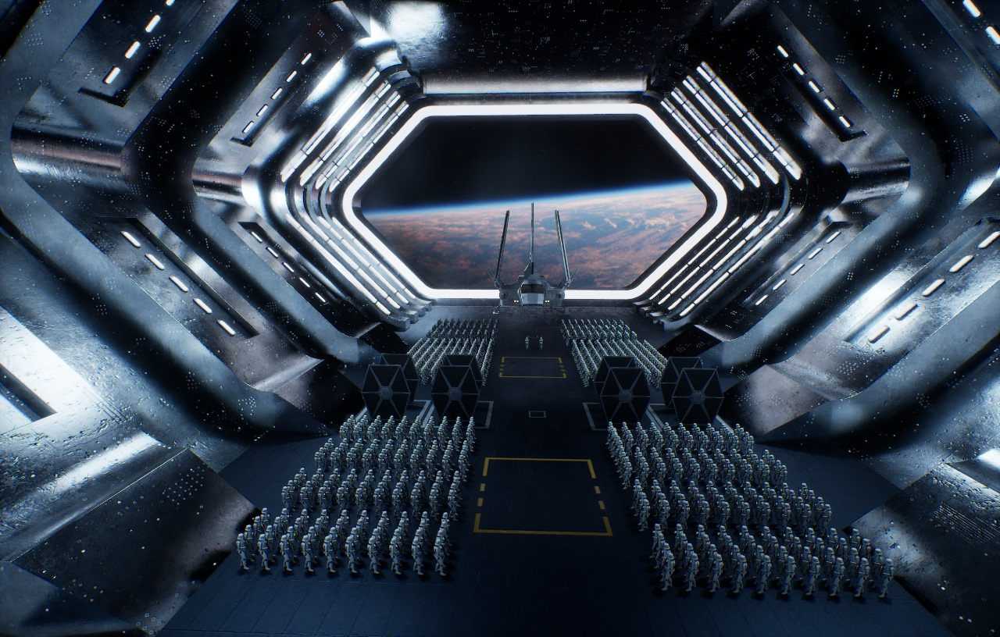
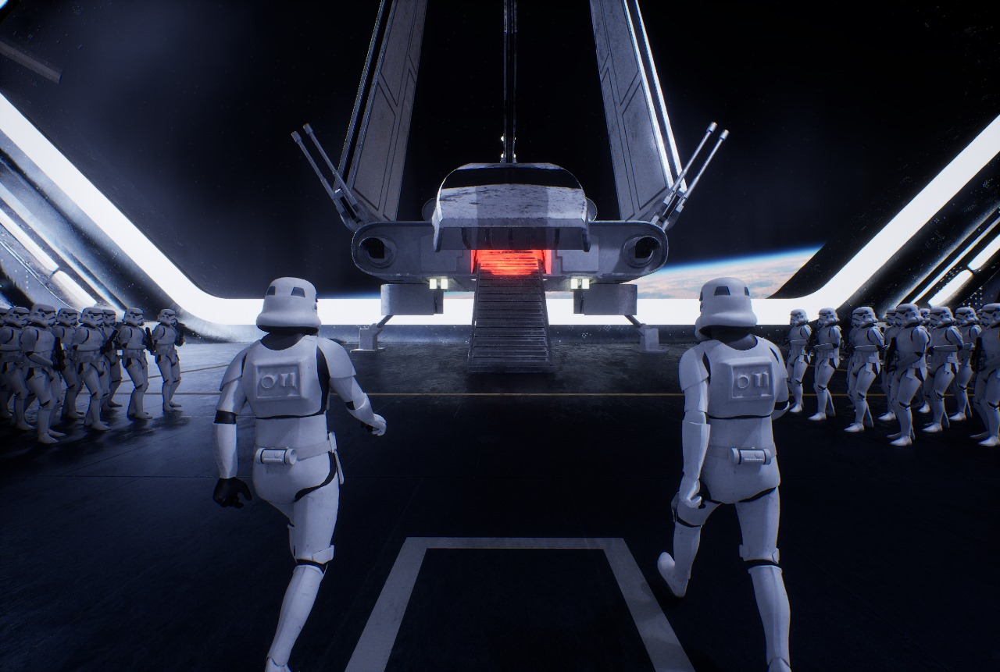
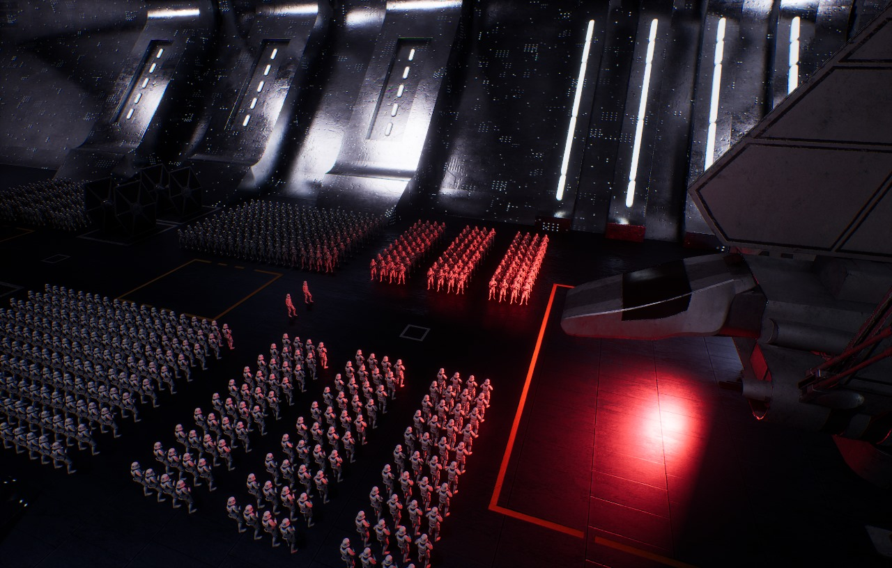
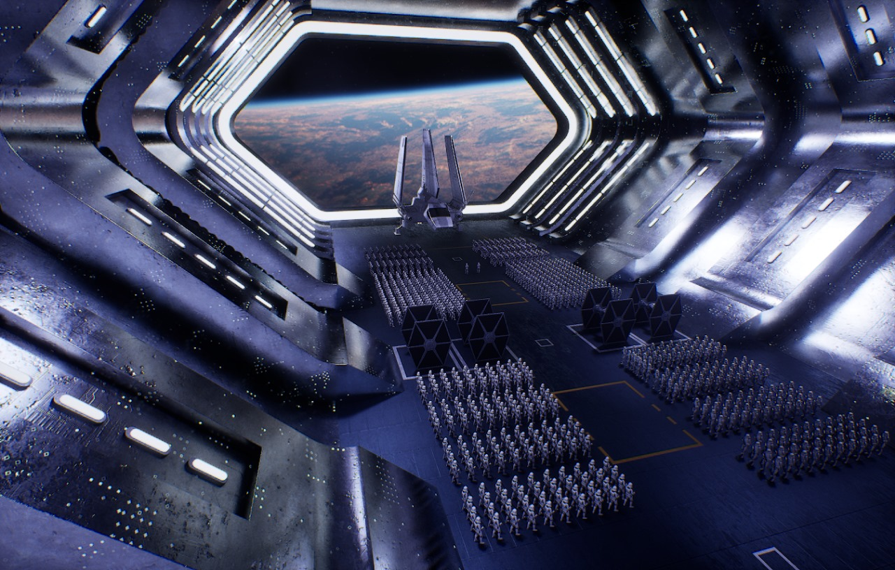

# Star Wars: Imperial Hangar Cinematic (Unreal Engine 5)

A cinematic environment and animation sequence built in **Unreal Engine 5**, featuring an Imperial Star Destroyer hangar bay overlooking a planet in orbit, complete with Lambda-class T-4a shuttle boarding, TIE fighters, and battalion formations.



## Cinematic Highlights
* **Imperial Hangar Architecture:** Modular metallic paneling, emissive bay lighting strips, and a panoramic hangar bay opening overlooking planetary orbit.
* **Trooper Battalions & Boarding Sequence:** Rank-and-file Stormtrooper formations alongside an animated shuttle boarding sequence with E-11 blasters and interior red bay lighting.
* **Starfighters & Vehicles:** Detailed Lambda-class T-4a shuttle and docked TIE fighters staged across the flight deck.

## Gallery

| Shuttle Boarding Sequence | Battalion Formation & Lighting |
| :---: | :---: |
|  |  |

| Hangar Bay Overview |
| :---: |
|  |

## Project Structure
* `Config/` — Engine, input, lighting, and virtual production settings.
* `Content/` — Custom maps (`Main.umap`), Megascans surfaces, Lambda shuttle assets, Stormtrooper meshes, decals, HDRI skies, and materials.
* `Screenshots/` — High-resolution cinematic renders from the sequence.
* `Star_Wars.uproject` — Unreal Engine 5 project file.

## How to Clone & Open
This repository uses **Git LFS** (Large File Storage) to manage `.uasset` and `.umap` files.

1. Install [Git LFS](https://git-lfs.com/) and initialize it:
   ```bash
   git lfs install